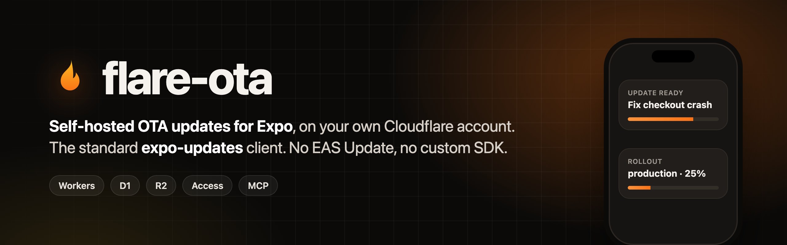
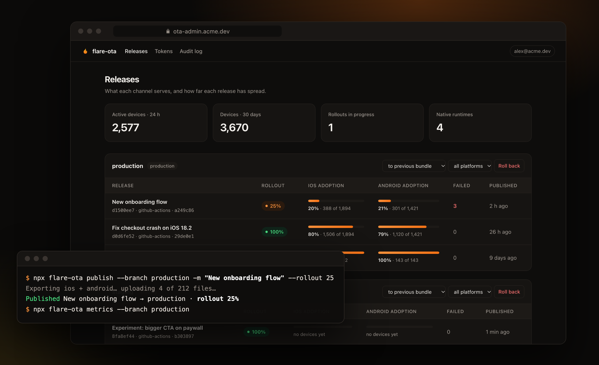
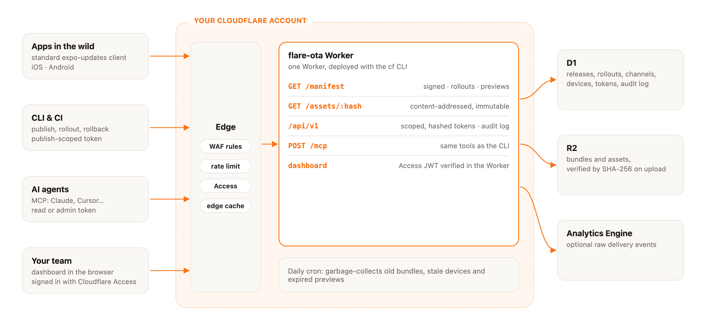

<p align="center">
  
</p>

<p align="center">
  <a href="https://github.com/Merlin1337/flare-ota/actions/workflows/ci.yml"></a>
  <a href="LICENSE"></a>
  
  
  
</p>

<p align="center">
  <a href="#quick-start"><b>Quick start</b></a> ·
  <a href="docs/expo-app.md">Expo integration</a> ·
  <a href="docs/ci.md">CI</a> ·
  <a href="docs/mcp.md">MCP</a> ·
  <a href="docs/costs.md">Costs</a> ·
  <a href="docs/security.md">Security</a>
</p>

<br>

<p align="center">
  
</p>

<br>

Ship JavaScript fixes to your Expo app in minutes, without a store review, on infrastructure you own.
flare-ota is a complete update server for the **standard `expo-updates` client**: no fork, no
custom native SDK, no EAS Update. It runs as a single Cloudflare Worker on **your** account, where
the free tier covers a small app and $5/month covers a large one.

## Why flare-ota

<table>
<tr>
<td width="33%" valign="top">

**Own the pipeline**

Bundles, devices and keys stay in your Cloudflare account. Deploy with Cloudflare's `cf` CLI;
no third-party service in the update path.

</td>
<td width="33%" valign="top">

**Release like a pro team**

Progressive rollouts, pause, one-command rollback, promote staging → production, and signed
preview links to test one release on one phone.

</td>
<td width="33%" valign="top">

**Secure by default**

Signed manifests, scoped hashed tokens, a dashboard behind Cloudflare Access whose JWT the
Worker verifies itself, an audit log, and WAF rules.

</td>
</tr>
</table>

## Features

| | |
|---|---|
| **Expo Updates protocol v1** | Works with `expo-updates` as shipped. Code signing required, fingerprint runtime versions. |
| **Channels & branches** | Point `production` and `staging` at any branch; promote a tested release in one call. |
| **Progressive rollouts** | Deterministic per-device buckets, rollouts only grow, pause stops new devices. |
| **Rollback** | Back to the previous bundle, or to the JS embedded in the binary. Failed launches are never re-offered. |
| **Preview links** | Signed, expiring, revocable QR code that pins one device to a release, outside the rollout. |
| **Adoption metrics** | Served, running and failed per release and platform, against the eligible fleet. |
| **CLI** | `publish`, `rollout`, `pause`, `rollback`, `promote`, `preview`, `metrics`, `doctor`, all with `--json`. |
| **MCP server** | Remote (Streamable HTTP) and local (stdio). Agents see only the tools their token allows. |
| **Edge-cached assets** | Content-addressed, verified by SHA-256 on upload, immutable cache, daily garbage collection. |
| **Guided setup** | One rerunnable command: signing key, Access, D1, R2, deploy, first token, WAF, health check. |

## How it works

<picture>
  <source media="(prefers-color-scheme: dark)" srcset="docs/assets/architecture-dark.png">
  
</picture>

## Quick start

You need a Cloudflare account with a domain on it, Node 24.22+ and pnpm.

**1. Deploy the server** (guided, rerunnable)

```sh
git clone https://github.com/Merlin1337/flare-ota && cd flare-ota && pnpm install
npx cf auth login
pnpm server:setup --stage production
```

**2. Connect your Expo app**

```sh
npx expo install expo-updates && npm i -D flare-ota
cp ~/.flare-ota/flare-ota/certificate.pem certs/certificate.pem   # printed by setup
FLARE_OTA_URL=https://ota.example.com npx flare-ota init --channel production
```

Then build a release binary once: the update URL and certificate are native settings.

**3. Ship**

```sh
export FLARE_OTA_URL=https://ota.example.com FLARE_OTA_TOKEN=fota_…
npx flare-ota doctor                                    # config, server, token, signature
npx flare-ota publish --branch production -m "Fix checkout" --rollout 10
npx flare-ota rollout <groupId> 100                     # or: npx flare-ota rollback --branch production
```

Full walkthrough in [docs/quick-start.md](docs/quick-start.md).

## Talk to it from your AI agent

```sh
claude mcp add --transport http flare-ota https://ota.example.com/mcp \
  --header "Authorization: Bearer $FLARE_OTA_TOKEN"
```

> *"How is today's release doing on Android?"* · *"Raise it to 50%."* · *"Roll production back."*

Give the agent a **read** token to look around, **admin** to let it act. Every action lands in
the audit log. See [docs/mcp.md](docs/mcp.md), or install the [Claude skill](skills/flare-ota/SKILL.md)
so Claude can set flare-ota up for an app end to end.

## flare-ota or EAS Update?

| | flare-ota | EAS Update |
|---|---|---|
| Client | standard `expo-updates` | standard `expo-updates` |
| Runs on | your Cloudflare account | Expo's infrastructure |
| Bundles and device data | your account | Expo's servers |
| Pricing | Cloudflare usage: free tier, then Workers Paid ($5/mo) | Expo plans |
| Server code | open source (MIT) | hosted service |

EAS Update is the zero-ops choice and integrates with EAS Build. flare-ota is for teams that want
the update path in their own account, open code, and costs that track Cloudflare's.

## Documentation

| | |
|---|---|
| [Quick start](docs/quick-start.md) | Deploy the server, connect an app, publish, roll back |
| [Expo app integration](docs/expo-app.md) | app.json, certificates, staging builds, preview links, gotchas |
| [CI](docs/ci.md) | Publish from GitHub Actions; deploy the server with a scoped token |
| [MCP](docs/mcp.md) | Remote and local MCP, the tool list and scopes |
| [Costs and limits](docs/costs.md) | Free tier vs Workers Paid, what each request costs |
| [Security](docs/security.md) | Threat model and protections |
| [Example app](examples/expo-app) | Minimal Expo app to try publish → update → rollback → preview |

Want to see the dashboard without deploying? `pnpm --filter @flare-ota/server demo` serves it on
`localhost:8799` with sample data.

## Status

**Beta.** Validated end to end on an iOS release build (Expo SDK 58) against a real deployment:
signed publish → update, rollback to the previous bundle, rollback to the embedded bundle, and a
preview link pinning one device to a paused 1% canary. Not yet exercised on a device: Android and
`exitPreview()`. Cloudflare's `cf` CLI and its `cloudflare.config.ts` format are in open beta.

Planned: delta patches (bsdiff), OAuth for the remote MCP server.

## Credits

Built from the designs of [focux/open-ota](https://github.com/focux/open-ota) (Cloudflare-native
protocol server) and [dnlsilva/open-ota](https://github.com/dnlsilva/open-ota) (MCP, preview
links, metrics). A few functions are adapted from focux/open-ota under its MIT license; see
[NOTICE.md](NOTICE.md).

## License

[MIT](LICENSE)
